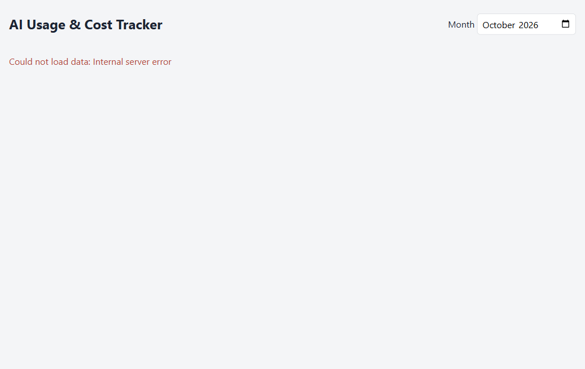
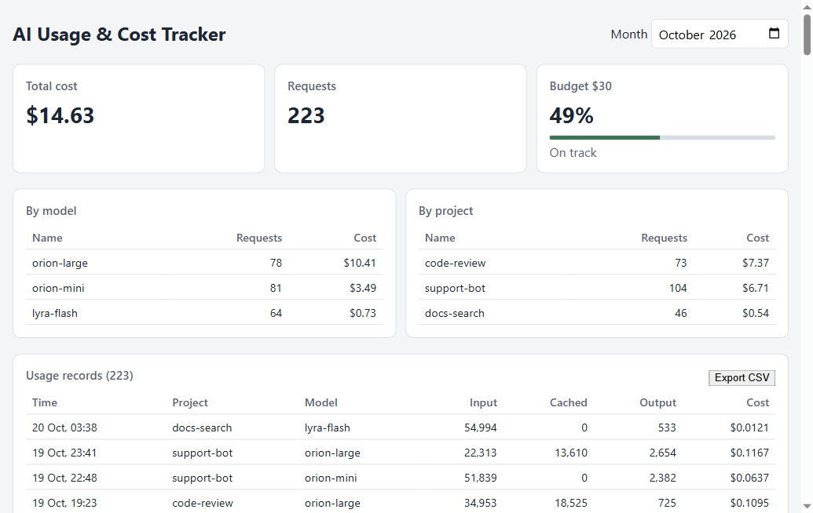

# Exercise: one MCP tool end to end in a session

Day 8 asks for one MCP tool used end to end in a session, for example querying pull requests and
commenting on one. I did it twice: Playwright MCP drove the running app for ticket EXP-106, and
the GitHub MCP server read and commented on the matching pull request.

| Item | Tools | Evidence | Result |
|---|---|---|---|
| Reproduce EXP-106 on the dashboard | `browser_navigate`, `browser_evaluate`, `browser_take_screenshot` | `POST` with `inputTokens: 9007199254740994` → `201`; then `GET /api/usage`, `GET /api/summary` and a valid `POST` → `500`; dashboard shows "Could not load data: Internal server error" | Pass |
| Verify the fix | Same tools, plus `browser_wait_for` | Same `POST` → `400` `inputTokens must not exceed 9007199254740991`; reads → `200`; dashboard shows October 2026 ($14.63, 223 requests) | Pass |
| Query and comment on a pull request | GitHub MCP: list and read the PR, `pull_request_review_write` | [PR #1](https://github.com/huynguyenduc-agilityio/claude-training/pull/1) on the GitHub mirror: summary of the diff, then one `COMMENTED` review, posted after I approved the text, "allow once" | Pass |

The fix itself shipped in
[MR !15](https://gitlab.asoft-python.com/huy.nguyenduc/claude-training/-/merge_requests/15)
(95 tests). PR #1 was opened only for the exercise and closed afterwards; review and merge stay on
GitLab.

Before the fix:

After the fix:

## How it went

1. Playwright MCP was added to `.mcp.json` and merged first, so the EXP-106 worktree had it.
2. The planned tool for the pull request part was the official GitLab MCP server, because the
   repository lives on GitLab. OAuth login worked, but every authorized call returned `404`: MCP
   is not enabled on the company instance. The server was removed.
3. The course wording (GitHub) was then followed on the public GitHub mirror, with a fine-grained
   token limited to that repository and to the pull request toolset.
4. The comment was drafted in chat, approved, and posted once. The server was removed afterwards;
   the token is revoked on GitHub (Settings → Personal access tokens).

## What I would do differently

- Probe a new MCP server with a real `initialize` call before writing the plan around it.
- Add `.playwright-mcp/` to `.gitignore` in the same merge request as `.mcp.json`.
- Add the token-based server from a terminal that does not get pasted into chat, or clear the
  terminal right after the command.
